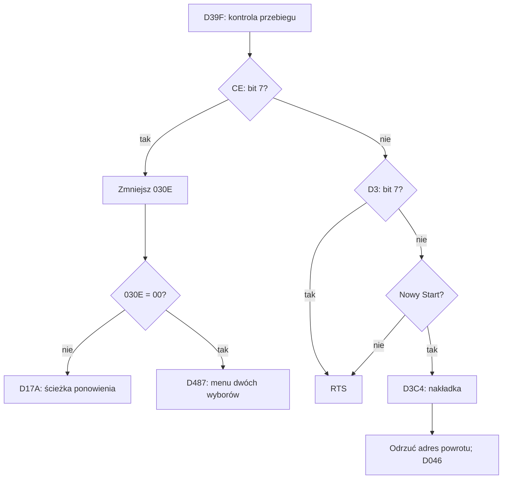

# Pętla główna, kontroler i przejścia sterowania — etap 01B

Analiza dotyczy wyłącznie dostarczonego ROM-u o SHA-256
`00ad4a0c6612319bb9f918ca36d6e93b4e5d996716c0570a3ec92bd60533881b`.
Wartości bez prefiksu w tabelach adresowych i opisie bajtów są szesnastkowe; liczby iteracji są dziesiętne.
Przedziały w CSV są prawostronnie otwarte. Pełne współrzędne CPU/bank/PRG/plik znajdują się w
`analysis/reviewed_ranges.csv` i `analysis/reviewed_instructions.csv`.

## Zakres dowodów

Nowe ustalenia wynikają z odczytu instrukcji i kontrolowanego wykonania oryginalnych bajtów przez py65.
Testy nie modyfikują ROM-u. W testach przejść menu część wywołań jest zastępowana opisanymi granicami
procedur, aby oddzielić logikę wywołującego od nieprzeanalizowanych podsystemów. Każda grupa testowa
zawiera listę tych zastąpień. W testach pełnego `$D90C` wykonywany jest również prawdziwy kod obsługi
audio, ale tylko dla zainicjalizowanego, nieaktywnego stanu kanałów.

Nie uzyskano obrazu z emulatora NES ani pomiarów rzeczywistego czasu PPU/APU. Nazwy typu „front end”,
„overlay” i „scene” opisują lokalny przepływ; nazwy konkretnych ekranów i znaczenie wszystkich pól
rozgrywki wymagają dalszego potwierdzenia. Osobnych notatek użytkownika nie wykorzystano.

## 1. Odczyt kontrolera

`PRG0E:$D977–$D9CA` zapisuje 01, następnie 00 do `$4016`, po czym wykonuje osiem odczytów tego portu.
Każdy odczyt przechodzi przez `AND #03`, `CMP #01`, `ROL $1F`. Przeniesienie jest więc ustawione,
gdy co najmniej jeden z dwóch najmłodszych bitów odczytu jest jedynką. Pozostałe bity są ignorowane.
Po ośmiu przesunięciach stara zawartość `$001F` zostaje całkowicie usunięta. Wynik wraca też w A;
X wynosi 00, Y pozostaje niezmienione.

Kolejność szeregowa standardowego pada jest opisana w [NESdev Nestech.txt](https://www.nesdev.org/wiki/Nestech.txt),
sekcja „Joypads”. Po połączeniu tej dokumentacji z kierunkiem przesunięć w ROM-ie uzyskano:

| Przycisk | Maska w RAM | Numer odczytu |
|---|---:|---:|
| A | 80 | 1 |
| B | 40 | 2 |
| Select | 20 | 3 |
| Start | 10 | 4 |
| Up | 08 | 5 |
| Down | 04 | 6 |
| Left | 02 | 7 |
| Right | 01 | 8 |

`PRG0E:$D949–$D976` wykonuje dwa pełne, oddzielnie zatrzaśnięte odczyty. Dla poprzedniej wartości
trzymanych przycisków P oraz nowych próbek S1/S2:

```text
H = S1 AND S2
pressed = H AND (NOT P)
```

To operacja AND dwóch próbek. Kod nie powtarza odczytów aż do uzyskania zgodności. Przy szybkiej zmianie
stanu między próbkami przycisk może zostać pominięty w tym uaktualnieniu. Sam ten kod nie dowodzi
odporności na wszystkie błędy odczytu związane z DMC DMA; takiego modelu nie testowano.

| RAM | Rola po zakończeniu uaktualnienia |
|---|---|
| `$001F` | Nowo naciśnięte przyciski; podczas odczytu jest buforem roboczym |
| `$0020` | Trzymane przyciski po AND próbek |
| `$0021` | Historia przycisku A: przesunięcie w lewo i dopisanie bieżącego A do bitu 0 |
| `$0713` | Poprzednia wartość trzymanych przycisków |
| `$0714` | Wcześniejsza wartość `$0713` |

Testy B_CPU01/02 obejmują wszystkie 256 masek i osobno wartości 01/02/03 w dolnych bitach magistrali.
B_CPU03 sprawdza naciśnięcie, trzymanie, zwolnienie, zmiany kombinacji i niezgodne próbki, wraz z historią
oraz zachowaniem X/Y i banków. To 11 przebiegów całego `$D90C` po inicjalizacji nieaktywnego audio.

## 2. Synchronizacja z NMI i zależność od czasu

`PRG0E:$D90C` odkłada X/Y na stos. Pętla `$D910–$D91A` wykonuje aktualizację `$0097`, a potem sprawdza
`$0095`. Przy wartości niezerowej powtarza oczekiwanie; przy zerze przechodzi do `INC $95`.
W NMI instrukcja `PRG0F:$F116` zapisuje do `$0095` X. We wcześniej ustalonym i ponownie przetestowanym
kontekście `$0096` równym 00 lub 01 jest to zero. Dawna nazwa `NmiChrStartIndexShadow` została zatem
zastąpiona dokładniejszą `FrameNmiHandshake`; podwójna rola tego zapisu pozostaje opisana w mapie RAM.

Aktualizacja bajtu `$0097` w oczekiwaniu to obrót o jeden bit w lewo **po inkrementacji z zawinięciem**:

```text
z = (state + 1) modulo 256
state = rotate_left_8(z, 1)
```

`CMP #80` ustawia przeniesienie zgodnie z bitem 7 wartości z, dlatego następujący `ROL` daje obrót,
a nie zwykłe przesunięcie. Aktualizacja zachodzi przynajmniej raz nawet wtedy, gdy `$0095` było już zerem.

Osobna procedura `PRG0E:$D9CB–$D9D6` wykonuje:

```text
state = ((((state + X) modulo 256) XOR AA) + BD) modulo 256
```

Testy sprawdziły 256 stanów pierwszej transformacji oraz 1536 kombinacji drugiej (wszystkie stany przy
sześciu granicznych wartościach X). Nie przypisano jeszcze wszystkim konsumentom `$0097` znaczenia RNG.
Zależność od liczby iteracji oczekiwania jest jednak bezpośrednio wykazana: od stanu 7E, po 1/3/17
iteracjach uzyskano FE/00/3E.

B_CPU04 uruchamia rzeczywisty handler NMI przy wybranym dojściu do `$D918`, następnie kontynuuje
oryginalny kod. Moment dostarczenia NMI jest syntetyczny. Bez NMI po 200 instrukcjach procesor pozostaje
w pętli oczekiwania. Test nie określa długości klatki, opóźnienia wejścia ani dokładnego skanowania ekranu.

Po sygnale NMI `$D90C` zeruje `$03D8/$03D9`, zapisuje banki rozpoznane przez `$9FFF/$BFFF`, mapuje
R6=00/R7=01 i wywołuje `$C7C7`. Następnie odtwarza oba banki i aktualizuje kontroler. Odtwarzanie zależy
od prawidłowych znaczników banków; nie jest gwarantowane dla dowolnie ustawionej zawartości okien ROM.

## 3. Rozwinięta pętla czterofazowa

Główny cykl mieści się w `PRG0E:$D046–$D0B6`. Jest zapisany jako cztery kolejne bloki kodu; nie znaleziono
tu zmiennej „numer fazy”. `$009A` indeksuje dane kontekstu/sceny, a nie te cztery fazy.
Na końcu występuje bezwarunkowy powrót do `$D046`.

| Faza | Początek | Kolejność wywołań |
|---:|---|---|
| 0 | `$D04E` | D90C, D0B7, D0BA, D0DC, D0D2, D107, D63B, D110 |
| 1 | `$D066` | D90C, D0B7, D0BA, D0F3, D0D2, D107, D63B, D9CB, D110 |
| 2 | `$D081` | D90C, D0B7, D0BA, D0DC, D107, D0D2, D63B, D110 |
| 3 | `$D099` | D90C, D0B7, D0BA, D0F3, D107, D0D2, D63B, D9CB, D110 |

Każda faza zawiera jedno wywołanie synchronizacji `$D90C`; fazy 1 i 3 dodatkowo wywołują mieszanie
`$D9CB`. Kolejność `$D0D2` i `$D107` zamienia się w drugiej połowie cyklu. Nie wyprowadzono z tego
automatycznie częstotliwości poszczególnych podsystemów: nie prześledzono wszystkich blokujących
wywołań ani możliwego przekroczenia czasu klatki.

| Wrapper | Ustawienie banków | Pierwszy cel w przełączanym oknie |
|---|---|---|
| `$D0BA` | R6 = `$03B9`, R7 = 08 | PRG08:$A006 → $ABC5 |
| `$D0D2` | R7 = 09 | PRG09:$A000 → $BE90 |
| `$D0DC` | R6 = `$03B9`, R7 = 07 | PRG07:$A078 → $A0DB |
| `$D0F3` | R6 = `$03B9`, R7 = 07 | PRG07:$A07B → $A0FA |
| `$D110` | po `$E2A3`: R6 = 06, R7 = 08 | PRG08:$A00C → $A012 |

Pierwsze cele wynikają z jawnego zapisu MMC3 i zostały wykonane do granicy procedury w B_CPU07.
Późniejsze wywołania we wrapperach zachowują status nierozstrzygnięty, jeżeli po drodze występuje
nieprzeanalizowany callee mogący zmienić bank. Nie zakładamy, że każdy callee zachowuje R7.
B_CPU08 potwierdza porządek 34 wywołań i skok powrotny, zastępując ich ciała granicami procedur;
nie jest to test pełnego cyklu rozgrywki.

Zapisano również 88 wpisów tablic skoków: 42 w banku 0E, 33 w 07, 6 w 08 i 7 w 09.
`analysis/service_jump_tables.csv` rozróżnia fizyczne banki nawet przy identycznym adresie CPU `$A000`.

## 4. Przejścia sterowania i stos

`PRG0E:$CF50` ustawia R7=09 i wywołuje `$A009`, którego wpis skacze do `$A499`.
Wynik Carry=0 powoduje ponowne wejście przez wywołanie `$A00C`; Carry=1 przechodzi do `$CF6D`.
Sekwencja `$A499` zachowuje wynik carry na stosie przez wywołania końcowego wygaszania/sprzątania.

`PRG09:$A630` traktuje nowo naciśnięte A lub Start jako potwierdzenie. Select, Left lub Right przełączają
`$002C` operacją XOR 01. Jednoczesne naciśnięcie kilku z tych trzech przycisków daje jedno przełączenie.
Potwierdzenie ma pierwszeństwo. B nie potwierdza tego wyboru. Kursor jest pojedynczym sprite'em
z Y=98, kafelkiem 2D, atrybutem 01 i X=38/88. B_CPU15 wykonuje także faktyczny zapis kursora i ukrywanie
pozostałych sprite'ów; zastąpiono wyłącznie dostarczenie nowego wejścia przez `$C74C`.

Gdy działa pętla rozgrywki, `$D0B7` skacze do `$D39F`. Lokalne reguły są następujące:



Znaczenie producenta `$00CE` pozostaje nieustalone. Nazwa `$030E` — `RemainingAttemptsCandidate` —
jest celowo kwalifikowana: kod inicjalizuje ją wartością 03, zmniejsza na opisanej ścieżce i przy zerze
otwiera menu. Pełne utożsamienie z liczbą żyć wymaga prześledzenia producentów stanu i obserwacji gry.

Nakładka zapisuje i odtwarza rejestry CHR `$0047/$0048` oraz palety. Przy powrocie `$D454/$D455` wykonują
dwa `PLA`, usuwając adres powrotu wywołania `$D0B7`, po czym następuje `JMP $D046`. To nie jest zwykły RTS.
Test B_CPU10 potwierdza przywracanie danych oraz ten efekt stosu z jawnie zastąpionymi procedurami
nakładki, wygaszania i przeliczenia przewijania. W pełnym wejściu do rozgrywki `$CFE8` dodatkowo odtwarza
SP zapisany w `$016F`, co również ma znaczenie dla śledzenia stosu w debuggerze.

Menu przy zerowym liczniku używa innego zestawu wejść niż front end: A/B/Start potwierdzają, Up/Down
wybierają pozycję, Select przełącza. Wybór 00 przechodzi do `$D19A`; wybór niezerowy po wywołaniach
sprzątających wykonuje `JMP ($FFFC)`, czyli trafia do wektora RESET `$F010` w dostarczonym ROM-ie.
B_CPU13/14 sprawdzają tę logikę bez przypisywania nieodczytanym elementom ekranu konkretnych napisów.

## 5. Trzy tablice tras scen

| Tabela w PRG0E | Rozmiar | Konsument |
|---|---:|---|
| `$D23F` | 32 bajty | `$D1AA`: następny indeks, FF to koniec cyklu |
| `$D25F` | 32 bajty | `$D178`: indeks przy ponowieniu; także `$D363` |
| `$D27F` | 32 bajty | `$D19A`: indeks ścieżki kontynuacji |

Wartości są zapisane w `analysis/scene_index_routes.csv`. Trasa następników od indeksu 00 odwiedza
29 indeksów, a FF występuje pod indeksem 1B. Indeksy 02, 03 i 0F nie należą do tego jednego łańcucha;
sam ten fakt nie dowodzi, że są nieużywane. Mogą mieć inne wejścia. Nie przypisano indeksom nazw etapów,
bossów, pomieszczeń ani sekretów.

Po FF kod wywołuje wpis banku 09 `$A012`. `$030C` jest zwiększane, o ile nie jest równe 03; dla normalnego
zakresu 00–03 oznacza nasycenie na 03. Nie jest to ogólny clamp: wartość 04 wzrasta do 05, co sprawdzono
osobnym testem poza normalnym zakresem. Dla wyniku co najmniej 03 występuje dodatkowe wywołanie
banku 08 `$A00F`. Następny indeks sceny staje się 00. Konkretne skutki trudności pozostają nieustalone.

`$D225` odczytuje tabelę `$FDE0` indeksem `$D3 & 07` i kopiuje wynik do trzech bajtów RAM.
Zapisano ten efekt bez wprowadzania pochodzącej z osobnych notatek interpretacji HP.

## 6. Dodatkowe ustalenia

- `$F6CC`: poczekaj X aktualizacji. X=00 daje 256 wywołań, nie zero.
- `$F6D3`: podobne oczekiwanie, przerywane nowym A lub Start.
- `$F6E0`: czekaj na nowe A lub Start bez licznika.
- `$E2A3`: dla `$06EE=FF` odtwórz 32 bajty palety, wyzeruj flagę i ustaw polecenie NMI 0E.
  Dalsza część dobiera dwa kolory, używając `$03D5` i bitu 10 pola `$D9`.
- `$E2E2`: nieparzysty `$03D6` dodaje 04 do pionowego przewijania; dla pierwszego wyniku co najmniej F0
  dodaje jeszcze 10. Sprawdzono zawijanie przy granicach EC/F0/FC/FF.
- `$D37F/$D38B`: kopiowanie bloku 11 bajtów między `$06C2–$06CC` a `$06CD–$06D7`.
  Znaczenie poszczególnych pól pozostaje nierozstrzygnięte.

## 7. Wyniki i następny krok

Nowy etap obejmuje 52 obszary (44 kodu i 8 danych), 1032 instrukcje i 2475 bajtów.
Łącznie z etapem 01A: 68 obszarów kodu, 11 danych, 1463 instrukcje, 3444 bajty PRG (2,6276%).
Te liczby opisują przejrzane zakresy z lokalną semantyką, nie liczbę kompletnie zrozumianych podsystemów
ani dokładną liczbę funkcji. Tablice skoków i obszary o wielu wejściach są liczone jako zakresy.

Nowe wyniki CPU: 18 grup, 2295 wektorów, 14033 wiersze wybranych śladów; wszystkie grupy PASS.
57 wcześniejszych przypadków zachowano bez powtarzania. Szczegóły:
`cpu_stage01B.json`, `cpu_stage01B_vectors.csv`, `cpu_stage01B_trace.csv` oraz skrypt `cpu_stage01b.py`.

Najbliższe zadania: producenci `$CE/$D3/$03B9`, ciała procedur banków 07/08/09, powiązanie 32 indeksów
z danymi świata, a następnie niezależne znaczenie pól HP/MP/EXP. Równolegle potrzebna jest rzeczywista
weryfikacja w MesenCE, szczególnie przejść nakładki, czasu pętli i mapowania banków po callee.
