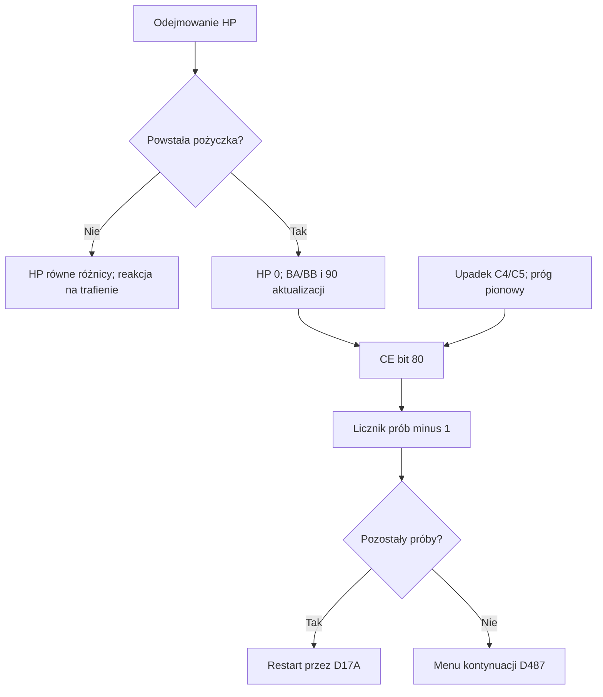

# KickMaster NTSC-U — gracz, obrażenia i konfiguracja scen

Etap 02A, 2026-10-20. Analiza wyłącznie dostarczonego ROM-u o SHA-256
`00ad4a0c6612319bb9f918ca36d6e93b4e5d996716c0570a3ec92bd60533881b`.
Ustalenia pochodzą z kodu i tabel ROM-u oraz kontrolowanych testów CPU. Nie wykorzystano
wcześniejszych notatek użytkownika o adresach HP/EXP jako źródła odkryć.

Adresy w tekście mają prefiks `$`; wartości szesnastkowe go nie mają. Liczby aktualizacji,
liczby rekordów i rozmiary podane bez oznaczenia „hex” są dziesiętne. Przedziały kodu są
lewostronnie domknięte. Pełne adresy CPU, banku, PRG i pliku są w `reviewed_ranges.csv`.

## Najważniejsze ustalenia i zakres dowodu

| Ustalenie | Dowód | Ograniczenie |
|---|---|---|
| `$03B9` wybiera bank danych sceny w oknie `$8000` | PRG07:$A537, $A5AB; C_CPU01/02 | Nie jest uniwersalnym bankiem kodu gracza |
| `$CD` łączy kod stanu/klatki z kierunkiem sprite’a w bicie 0 | PRG08:$ACF7; PRG0F:$F6ED/$F737; C_CPU06/14/15 | 111 par kodów nie oznacza 111 różnych zachowań |
| `$06B9` jest bieżącym HP w jednostkach wewnętrznych | PRG0E:$DDD9; PRG07:$B04B; C_CPU08/10/13 | Nie przeanalizowano jeszcze wszystkich zapisów, leczenia ani awansów |
| `$06BA` jest wygładzaną kopią HP do paska | PRG07:$B04B; C_CPU13 | Przyrost o jeden dotyczy wywołania tej procedury, nie każdego VBlank |
| `$CE` i `$D3` zawierają wiele flag | PRG08:$AB19, $BB2B, $BB4F, $BB6E; C_CPU07/10/11 | Nie są pojedynczymi numerami globalnego stanu gry |
| Pożyczka przy odejmowaniu HP rozpoczyna śmierć; wynik zero bez pożyczki uruchamia reakcję na trafienie | PRG0E:$DDE9; C_CPU08 | To lokalna reguła tej procedury, nie twierdzenie o wszystkich możliwych drogach śmierci |

## Konfiguracje scen i bank danych

PRG07:$A4E9 inicjalizuje współrzędne, a następnie przechodzi do `$A537`.
Indeks `$9A` jest maskowany przez 7F, lecz tablice mają po 32 wpisy. Maska nie ogranicza
arbitralnego wejścia do poprawnego zakresu 00–1F. W testach wykonano wszystkie 32 poprawne
konfiguracje, łącznie z rzeczywistymi wywołaniami inicjalizacji scrolla, IRQ i palety.

| Tablica w PRG07 | Rozmiar | Przeznaczenie |
|---|---:|---|
| `$B1E2` | 32 | Początkowy starszy bajt X kamery; młodszy bajt zerowany |
| `$B202` | 32 | Początkowa liczba ekranów Y, mnożona przez F0 |
| `$B222`, `$B242` | po 32 | Przesunięcia początkowe gracza względem kamery |
| `$B262` | 32 | Bank do `$03B9` i MMC3 R6 |
| `$B282`, `$B2C2`, `$B302`, `$B342`, `$B382` | po 64 | Pary bajtów do `$B9/$BA`, `$BB/$BC`, `$BF/$C0`, `$BD/$BE`, `$C1/$C2` |
| `$B3C2` | 32 | Parametr `$03BA`, używany przez animację palety |
| `$B3E2` | 32 | Początkowe flagi kierunku i przewijania `$DB` |
| `$B402`, `$B422` | po 32 | Granica X jako numer strony; granica Y jako liczba ekranów F0 |
| `$B442` | 64 | Wskaźniki profili palety/CHR |

`scene_configurations.csv` zawiera wszystkie 32 rekordy. `scene_configuration_pointers.csv`
rozwija sześć wskaźników na rekord do 192 wpisów z pełnym adresem źródła i celu.
Cel w `$8000–$9FFF` zależy od R6; cel w `$A000–$BFFF` należy tutaj do rezydującego banku 07.
Przykładowo scena 17 ma bank danych 03, ale wskaźnik `$B9/$BA` wskazuje PRG07:$B59A,
a profil palety PRG07:$B563. Przypisanie wszystkich wskaźników do banku 03 byłoby błędem.

Loader palety `$A935` odczytuje profil o następującym lokalnym układzie:

| Offset w profilu (hex) | Liczba bajtów | Cel |
|---|---:|---|
| 00–0F | 16 | `$0123–$0132`; równolegle `$0143–$0152` otrzymuje 0F |
| 10–17 | 8 | `$017D–$0184` |
| 18 | 1 | `$06B8`; dalsza semantyka nieustalona |
| 19, 1A | 2 | Cienie CHR `$44`, `$45` |

Nie odtworzono jeszcze formatów geometrii wszystkich struktur wskazywanych przez pięć
pozostałych wskaźników. Nie przypisano 32 indeksom nazw ośmiu etapów ani map zewnętrznych.

Drugi zapis `$03B9` występuje w PRG07:$A5AB. `$04E2` wybiera jeden z 17 zestawów układu
specjalnego w `$B482–$B53C`. Bit 7 bajtu banku zwiększa początkową stronę X kamery,
a do R6 trafia wartość po AND 7F. Testy sprawdzają wszystkie 17 konfiguracji do wejścia
w `$A990`; dwie wcześniejsze procedury przygotowania obrazu zastąpiono jawnie opisanymi atrapami.
Dalszego renderowania tych układów nie potwierdzono.

## Współrzędne i scroll

| RAM | Rola lokalnie potwierdzona |
|---|---|
| `$A7/$A8` | X kamery, liczba 16-bitowa little-endian |
| `$A9/$AA` | Y kamery w liniowych pikselach |
| `$AD/$AE` | Pionowa granica wyliczona jako liczba ekranów × F0 |
| `$AF` | Pozioma granica jako numer strony |
| `$C9/$CA` | Y gracza |
| `$CB/$CC` | X gracza |
| `$D4–$D7` | Kopia współrzędnych gracza po aktualizacji, z wyjątkiem warunku `$06BD=0B` i `$0593!=0` |

PRG08:$AB19 odejmuje kamerę od pozycji gracza. Wynik pionowy trafia do `$22/$23`, poziomy
do `$24/$25`. Układ potwierdzają zapisy do Y i X rekordów OAM w rendererach `$F6ED/$F737`.

PRG0F:$F78B zamienia liniowe Y na numer ekranu o wysokości 240 i resztę. Dla wejść
A=00–0F, Y=00–FF wszystkie 4096 testów zgadzają się z dzieleniem pozycji przez 240.
Nie rozszerza to kontraktu na odczyty poza 16-bajtową tablicą korekt `$F7A1`.
Pomocnik PRG07:$AAB6 mnoży liczbę ekranów przez F0, ale jego pętla jest sterowana BPL:
dla 00–80 działa jak mnożenie bez znaku, dla 81–FF daje zero. Normalne tabele scen mieszczą
się w poprawnej dziedzinie.

PRG08:$B04C wykonuje automatyczny krok kamery, gdy ustawione są bity 08 i 01 w `$DB`.
Kierunek `(DB >> 1) & 03` oznacza kolejno Y+1, Y−1, X+1, X−1. Ustawia też bit 80.
Trzy procedury PRG07:$A0DB/$A0FA/$A119 wymagają bitów 80 i 01, po czym używają tego
samego selektora w różnych tablicach. Wszystkie 256 wartości `$DB` sprawdzono dla każdej
z trzech procedur; test zatrzymuje się na wybranym celu, nie interpretuje całego celu.

Sześć profili IRQ wybieranych przez PRG0F:$FE6C opisuje pary latch/indeks zakończone F0
i selektorem NMI. Loader `$FAD3` dobiera `$F83D`, `$F803` albo `$F7C2` zależnie od liczby
par i selektora. Są to potwierdzone dane inicjalizacji; dokładne scanline’y wymagają emulacji PPU.

## Stan gracza i wybór animacji

PRG08:$AB19 czyści bit 80 w `$D3`. Jeśli `$F8 & 20` jest niezerowe, przechodzi przez
PRG0E:$C79D do procedury zmiany sceny `$D1AA`. W zwykłej aktualizacji zachowuje z `$CE`
wyłącznie bit 01 i przekazuje go jako wybór rodziny tablic do `$ACF7`.

| Rodzina | CHR | Wskaźniki metasprite’ów | Wskaźniki procedur | Liczba par kodów |
|---|---|---|---|---:|
| 0 | PRG08:$B0A5 | PRG08:$B114 | PRG08:$B1F2 | 111 |
| 1 | PRG08:$BDF3 | PRG08:$BDF8 | PRG08:$BE02 | 5 |

Kod `CD >> 1` wybiera bajt CHR dla `$46`. Wartość `CD & FE` wybiera dwubajtowe wskaźniki
sprite’a i procedury. Rodzina 0 zawiera 22 różne adresy procedur, rodzina 1 trzy.
Wiele kodów jest zatem kolejnymi klatkami tego samego zachowania. Testy objęły wszystkie
232 kody uwzględniające obie wartości bitu kierunku, lecz nie wykonały wszystkich procedur docelowych.
Plik `player_state_dispatch.csv` zaznacza, które cele pozostają nieprzeanalizowane.

Bit 0 `$CD` wybiera renderowanie normalne lub odbite. Pomocnik `$ADE2` bada OR bieżącego
i dwóch wcześniejszych odczytów przycisków. Right ma pierwszeństwo nad Left i zeruje bit 0;
Left ustawia go. Renderer odbity XOR-uje atrybut 40 oraz używa przesunięcia X `-(offset+8)`.
Metasprite składa się z rekordów Y/tile/attribute/X, zakończonych bajtem FF w miejscu Y
następnego rekordu. Prawidłowy licznik `$99` ogranicza zapis do 64 sprite’ów.
To rekonstrukcja zapisów RAM/OAM, bez oglądania końcowego obrazu PPU.

## Obrażenia, zerowe HP i śmierć

PRG0E:$DDD9 przyjmuje obrażenia w A, a wejściowy carry zachowuje jako kierunek reakcji.
Jeśli `$D2` lub `$01A4` jest niezerowe, wraca bez zmiany HP. Znaczenie producenta `$01A4`
pozostaje nieustalone.

Po odjęciu obrażeń od `$06B9` instrukcja BCS w `$DDE9` rozdziela przypadki:

| Warunek bez znaku | Wynik |
|---|---|
| Obrażenia < HP | Zapis dodatniej różnicy; reakcja na trafienie |
| Obrażenia = HP | Zapis zera; ta sama reakcja na trafienie |
| Obrażenia > HP | Zapis zera; rozpoczęcie sekwencji śmierci |

W reakcji nieśmiertelnej `$D2` otrzymuje 3C, `$D3` bit 20, `$CF` zero, a bit 10 w `$D3`
odtwarza kierunek z wejściowego carry. Do żądania dźwięku `$01` trafia DE.
Nie ma w tej procedurze specjalnego pominięcia zerowych obrażeń: przy braku blokad też
uruchamiają tę gałąź. Nie jest to dowód, że normalny caller przekazuje zero.

Gałąź pożyczki zapisuje F4 do `$01`, zeruje dolną połówkę `$CE`, czyści bit 01 `$DB`,
ustawia bit 80 `$D3`, ustawia `$CD` na BA/BB z zachowaniem kierunku i zeruje `$CF` oraz HP.
Potem kod PRG08 daje następującą sekwencję:

| Liczba ukończonych aktualizacji po obrażeniach | Kod pary | Timer |
|---:|---|---|
| 0–14 | BA/BB | 00–0E |
| 15–29 | BC/BD | 00–0E |
| 30–44 | BE/BF | 00–0E |
| 45–59 | C0/C1 | 00–0E |
| 60–74 | C2/C3 | 00–0E |
| 75–89 | CA/CB | 00–0E |
| 90 | CA/CB | 0F; `$CE` bit 80 ustawiony |

Każda z 90 aktualizacji została wykonana na oryginalnym kodzie `$AB19`, dyspozytorze,
procedurach śmierci i rendererze, dla obu kierunków. Nie użyto atrap w samym tym przebiegu.
Następnie rzeczywisty `$D39F` zmniejszył `$030E` z 03 do 02 i skierował do `$D17A` z A=01.
Jedyna atrapa w końcowym kroku zastępowała wygaszanie palety `$E154`.
To mocny dowód połączenia śmierci z licznikiem prób, lecz pełna zgodność jego prezentacji
na HUD z terminem „lives” pozostaje do sprawdzenia.

Upadek jest osobną ścieżką: `$B007` ustawia C4/C5 i zeruje `$CE`. `$BB4F` dodaje cztery
do 16-bitowego Y gracza i ustawia bit 80 `$CE`, kiedy **młodszy bajt** różnicy względem
Y kamery jest co najmniej F0. Porównanie nie obejmuje starszych bajtów. Dla wybranych
pozycji test potwierdza to zachowanie również przy zawinięciu młodszego bajtu.

## Źródło obrażeń z terenu

PRG0E:$DB02 wybiera pomocnik odczytu przez bit 04 `$DB`. Wynik w `$3C` ma priorytety:
bit 40 daje zwrot 03; w przeciwnym razie bit 80 daje 00; dopiero pozostałe wartości mogą
wywołać obrażenia i OR bitów 0C do `$CE`.
Przy bicie 10 wywołanie `$DDD9` dostaje `$9A + 04` w A. Wyjątkiem jest kombinacja
`$06BD=08` i `$0593!=0`. To potwierdzony warunek odporności, bez przypisania nazwy zaklęcia.
1536 przypadków testuje tę klasyfikację i rzeczywiste odejmowanie HP; pomocniki pobrania
próbki terenu zastąpiono kontrolowanym wynikiem. Geometria i znaczenie wszystkich typów
kolizji nadal wymagają osobnej analizy.

## HP i bufor paska

| RAM | Znaczenie |
|---|---|
| `$06B9` | Bieżące HP, jednostki binarne |
| `$06BA` | Kopia HP używana do rysowania |
| `$06BB` | Pojemność paska w jednostkach binarnych; wszystkie globalne ograniczenia leczenia jeszcze nieprześledzone |
| `$0163–$016D` | 11 identyfikatorów kafelków przygotowanych przez `$B04B` |

Jeden pełny segment odpowiada 10 hex, czyli 16 jednostkom. Częściowe segmenty używają
par jednostek; najmłodszy bit nie zmienia wybranego kafelka. Procedura zapisuje 4F dla
pełnego segmentu, 48–4E dla częściowego, 47 dla pustego w obrębie pojemności i 3F poza nią.
Tablica PRG0F:$FDE0 zawiera 40,50,60,70,80,90,A0,B0, czyli pojemności 4–11 segmentów.
Przy przywracaniu indeksuje ją `$D3 & 07`; producent awansu/zmiany poziomu nie został jeszcze przeanalizowany.

Gdy `$06BA > $06B9`, kopia natychmiast maleje do bieżącego HP. Gdy jest mniejsza,
zwiększa się o jeden i ustawia żądanie dźwięku A1. Testy objęły wszystkie wartości HP
od zera do każdej z ośmiu pojemności, z kopią niższą, równą i wyższą w poprawnym zakresie:
2904 przypadki. Nie stwierdzono zabezpieczenia przed dowolnie uszkodzoną pojemnością.

`$B022` wybiera tę procedurę jako fazę 03 pięcioelementowego obiegu HUD. W normalnej
dziedzinie `$A1` kolejność celów to `$B165`, `$F681`, `$B04B`, `$B104`, `$B0B0`.
Bit 80 wyłącza dyspozytor; inne bity `$A1` uczestniczą też w transferach. Pełny kontrakt
współpracy z NMI należy jeszcze domknąć, więc przyrostu paska nie przeliczono na sekundy.

## Weryfikacja i stan projektu

Nowo: 67 zakresów — 33 kodu i 34 danych, 892 instrukcje, 3385 bajtów PRG.
Łącznie: 101 zakresów kodu, 45 danych, 2355 instrukcji, 6829 bajtów z opisanym lokalnym
znaczeniem, czyli 5,2101% PRG. To metryka rozłącznych zakresów, nie ocena procentu poznania gry.
Mapa RAM ma 80 wpisów, eksport 226 symboli, graf 325 krawędzi call/jump/table.
Plik klasyfikacji dzieli cały ROM na 198 ciągłych zakresów.

Wynik testów etapu: 18 grup, 10137 przypadków, 5921 zapisanych wierszy reprezentatywnych
śladów. Pełne wektory i jawne granice atrap są w `analysis/cpu_stage02A*`.
Starszych zestawów 01A/01B nie uruchamiano ponownie bez potrzeby; zachowano ich wyniki.
Przebudowa ca65/ld65 porównuje wszystkie 262160 bajtów i przechodzi. Jawne źródło opisuje
6845 bajtów razem z nagłówkiem; pozostałe 255315 bajtów pochodzi z `.incbin` oryginału.

Nie wykonano pełnej emulacji NES, importu w natywnym MesenCE/Ghidra, logu CDL ani obserwacji
animacji na ekranie. Nie ustalono jeszcze MP, EXP, procedur awansu, kompletnych ataków,
zbierania przedmiotów, nazw i map wszystkich scen ani pełnych kontraktów bankowania.
Najbliższe cele: PRG08:$B81D i kolejne procedury gracza, `$BCEF` i teren, zapisy HP
w leczeniu oraz producenci dolnych bitów `$D3`; następnie powiązanie z EXP i pickupami.
